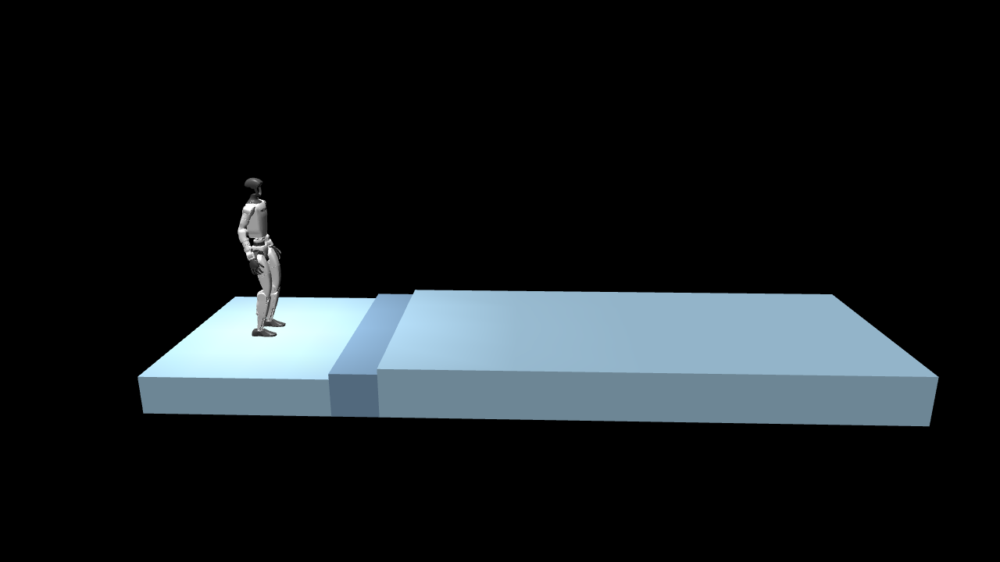
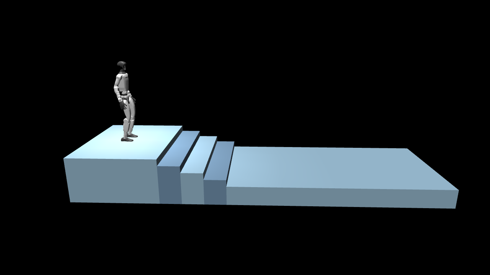
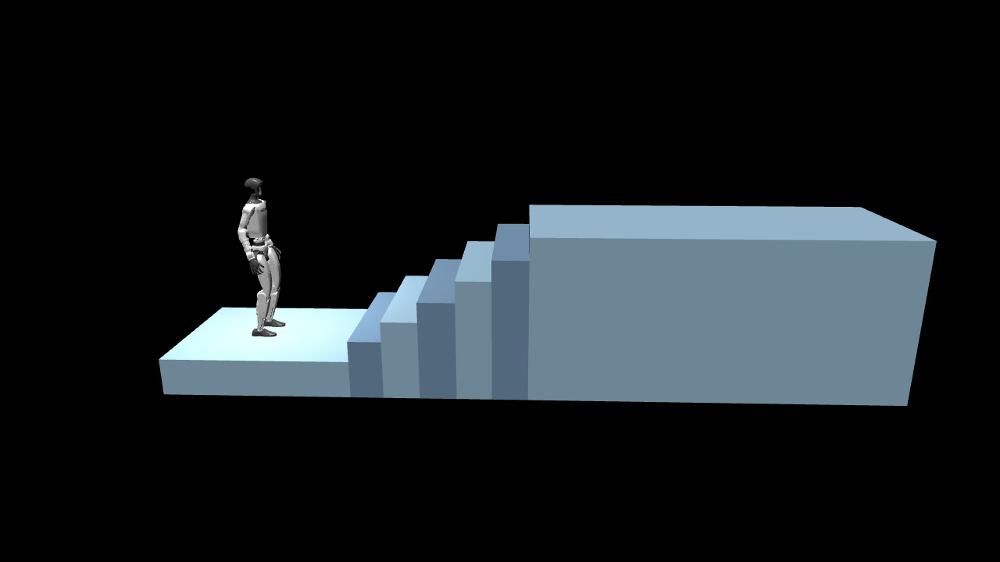
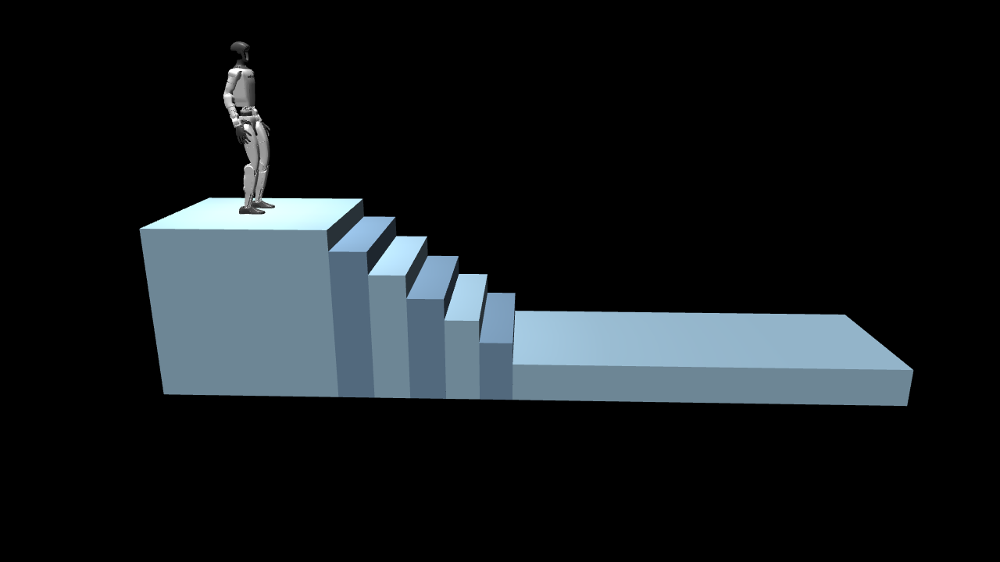

# Unitree G1 EDU stair training report

## What the robot learns

The simulated Unitree G1 EDU learns to walk forward up or down a straight flight of stairs, then reach the far landing on its feet. The task uses Unitree's 29-joint G1 model and joint-position controls. It starts from Unitree's flat-walking policy, which already knows how to balance and walk. Training adapts that policy to stairs and teaches it to use a terrain scan.

Each difficulty has four courses: standard ascent, standard descent, compact ascent, and compact descent. Compact stairs have shorter treads and narrower lanes. From level 2 onward, their individual risers and treads can vary by up to 8%.

| Level | Risers | Nominal riser height | Standard tread | Compact tread |
| --- | ---: | ---: | ---: | ---: |
| 0 | 0 | Flat | — | — |
| 1 | 2 | 4.5 cm | 36 cm | 31.5 cm |
| 2 | 3 | 7.5 cm | 35 cm | 30.5 cm |
| 3 | 4 | 10.5 cm | 34 cm | 29.5 cm |
| 4 | 5 | 14 cm | 33 cm | 28.5 cm |
| 5 | 6 | 17 cm | 32 cm | 27.5 cm |

The standard lane is 1.9 m wide. Compact lanes narrow from 1.8 m to 1.25 m as difficulty rises. For descent the robot begins at the upper landing and faces forward, just as it does for ascent.

## Do multiple robots learn at once?

**Yes. The reference run simulates 6,144 copies of the G1 at once.** Each copy has its own physics world, stair course, and episode. The robots run in parallel and share what they learn through one policy. They never interact with one another. The course previews show one world at a time.

| Setting | Reference run |
| --- | --- |
| GPUs | 2 Tesla T4s, 15 GiB each |
| CPU | 4 logical threads, with 2 numerical-library threads per worker |
| Parallel worlds | 3,072 per GPU, 6,144 total |
| Steps collected per update | 24 per robot, 147,456 total |
| Planned length | 160 updates, 23,592,960 simulated steps |
| Physics and control | Physics at 200 Hz, policy actions at 50 Hz |
| Episode limit | 14 simulated seconds |
| Training seed and terrain seed | 42 and 41 |
| Checkpoints | Every 20 updates and after the final update |
| Benchmarked speed | 38,200 simulated steps per second at this rollout size |

Each GPU collects a batch of experience from its own robots. It then computes a proposed update to the policy. The two workers average those updates and apply them together, so they train the same policy. A simulated step advances one robot by 20 milliseconds. The benchmark counts steps across all robots and both GPUs.

## How PPO trains the robot

The algorithm is **Proximal Policy Optimization**, or PPO, from RSL-RL. At each step, the **actor** reads the robot's sensors and chooses 29 joint-position targets. The **critic** estimates how much reward the robot can earn from its current situation. Training compares what happened with that estimate. PPO makes actions that did better than expected more likely and limits the size of each change to reduce the risk of losing useful behavior.

1. The robots try actions for 24 control steps each. Training adds a small amount of randomness so they try different movements.
2. The simulator measures progress, balance, foot contact, and whether each robot completes the course.
3. PPO reuses the collected experience for five passes, in four smaller batches per pass, then collects new experience with the updated policy.
4. Each world advances through the curriculum at its own pace. The world moves up a level after a successful landing. A fall, leaving the lane, or timing out before 65% of the course moves it down one level. A late timeout repeats the level. Level 5 is the cap.

| PPO setting | Value | What it controls |
| --- | ---: | --- |
| Learning rate | 0.0003, fixed | Size of optimizer updates |
| PPO clip range | 0.20 | Limits how far the updated policy can move from the previous one during a batch |
| Learning passes and batches | 5 passes, 4 batches per pass | How PPO reuses each set of collected steps |
| Reward discount | 0.99 | Gives rewards further in the future slightly less weight |
| Advantage smoothing, GAE λ | 0.95 | Balances nearby outcomes with longer-term estimates |
| Exploration bonus | 0.003 | Encourages the policy to keep trying different actions |
| Starting action noise | 0.28 standard deviation | Adds exploration around the transferred flat-walking actions |
| Actor and critic layers | 512, 256, 128 units with ELU | Size of the two networks |
| Critic loss weight and gradient limit | 1.0 and 1.0 | Weight of value prediction and cap on unusually large updates |

### What the policy sees

The actor receives 161 values. The first 98 cover motion and balance from the IMU, the speed and heading command, the phase of the walking cycle, joint angles and velocities, and the previous action. The last 63 describe the terrain on a grid around the pelvis. The grid has 9 points forward and backward by 7 points side to side, with 20 cm spacing. It rotates with the robot's heading.

The critic gets 176 values during training, including additional body speed and foot information. Each episode uses a forward speed target between 0.45 and 0.70 m/s. The robot starts with a small random position and heading offset. Training also varies foot friction, encoder readings, and the torso's center of mass to help the policy handle small changes.

### What earns reward

The robot earns reward for moving forward at the target speed, keeping its heading, and finishing on the landing. A landing counts when the pelvis crosses the finish line, both feet are supported on the landing, and the robot is upright. The policy loses reward for drifting sideways, slipping, landing hard, moving joints abruptly, hitting its own body, or falling. The stairs task allows vertical movement so the robot can step up and down while still tracking its forward speed.

| Selected reward or penalty | Configured weight |
| --- | ---: |
| Forward-speed tracking | +1.2 |
| Heading-rate tracking | +1.0 |
| Forward progress | +1.0 |
| Staying near the lane center | −2.0 × squared sideways offset |
| Supported finish | +250.0 on the finishing step |
| Fall or leaving the lane | −150.0 on the failure step |

MuJoCo applies these weights to different measurements and scales the reward by the control-step duration. The numbers in the table are configuration weights.

## Course screenshots

These screenshots show the starting positions and geometry that the simulator uses for training.

| Standard ascent · level 1 | Standard descent · level 3 |
| --- | --- |
|  |  |
| **Compact ascent · level 5** | **Compact descent · level 5** |
|  |  |

The renderer writes 1280 × 720 clips under `/kaggle/content/g1-edu-stairs/videos`. Each recorded clip shows one selected simulation episode. Use the evaluation counts to judge how often the robot finishes.

## Evaluation and deployment

The evaluation tests 16 episodes for each of the 24 course and difficulty combinations, for 384 episodes in total. It uses terrain seed 79, with different step placement and compact stair dimensions from training. It records completed landings, falls, lane exits, and timeouts. The evaluator can also compare the exported ONNX policy against the PyTorch policy using observations from the simulator.

The simulator and export use Unitree's motor order and joint settings. Physical use with SDK2 still needs a terrain sensor that provides the 63 terrain values and a heading command aligned with the flight. The work here uses the simulated G1 EDU.

[Kaggle setup and recovery](kaggle-recovery.md) · [Experiment index](../experiments/README.md) · [Reference settings](../experiments/profiles/kaggle-reference.env)
