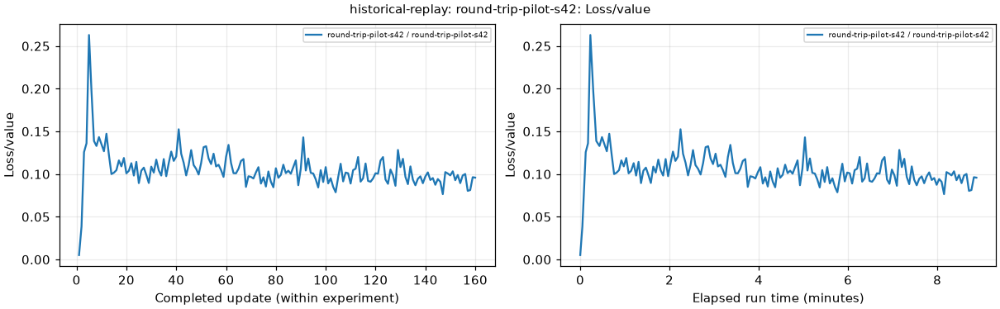

# Metrics and readiness implementation

No PPO or student optimizer updates were performed during this work. All existing tasks, stages and levels remain available.

## Completed and published

- The reporting integration suite read actual saved TensorBoard logs from two earlier runs and generated 501 PNG plots, alongside explicitly labelled synthetic fixtures.
- Raw CSV data, metric inventories, missing-value reports, and plots by update/run time and experiment time are generated by scripts.
- Held-out rates use trial counts. Speed summaries use observed trials; unobserved specialist speeds are omitted.
- A separate student validation environment measures MSE without changing weights, normalization or training random streams.
- Queued GitHub delivery was exercised with the real Windows watcher: the archive, checksum and smaller report ZIP were uploaded, then an unchanged snapshot was skipped.
- Local CPU reporting and mocked orchestration tests cover initialization/resume, both evaluation suites, specialist goals, failed-run publication and GPU telemetry parsing. Launcher tests cover bounded wireless retries and the no-training default.

The [VM reporting smoke release](https://github.com/ahmedelbamby-aast/g1-edu-stairs/releases/tag/run-metrics-readiness-smoke-v1) contains the original raw reporting artifacts and plots. The [local verification release](https://github.com/ahmedelbamby-aast/g1-edu-stairs/releases/tag/run-metrics-local-readiness-v5) contains the final offline script checks, logs and publication state. Both have local recovery copies under `outputs/runs`.

The committed proof files are [local readiness](local-readiness.json), [metric checks](metric-smoke.json), [workflow checks](workflow-smoke.json), [launcher guard log](launch-guard.log), [publication receipt](publish-receipt.json), and [archived VM reporting checks](vm-reporting-smoke.json). The workflow test also verifies that nested readiness fixtures cannot enter the real training catalog, and that raw results remain queued after a plotting failure.

The [metrics guide](../../../doc/training-metrics.md) lists every metric source, saved file, time axis, publishing dependency and rerun command.

## Before the VM went offline

The following execution checks completed on the VM: two simultaneous 1,080-world T4 capacity checks, NCCL all-reduce/barrier, all 13 task entries and stair-phase fixtures, 972-world independent student validation, and held-out full-route and turn-specialist evaluations. They used inference or controlled fixtures only. About 13.5 GiB remained free per T4 in the capacity check. No backward/optimizer pass or new training throughput was measured.

The final combined Windows preflight printed both GPU pass messages, then SSH disconnected. Some later VM-only raw reports were not uploaded before shutdown. They must be reproduced on the returning server; this directory does not claim to preserve those missing files.

**This was the offline status at the end of that session.** It is superseded by the [fresh-server recovery and delivery verification](../server-recovery-20261112/). Offline code verification and fresh GPU readiness remain separate records.

## Example saved curve

This is an earlier training run, replotted from its saved records. It shows completed updates on the left and elapsed run time on the right. It is not evidence of new training in this implementation session.
