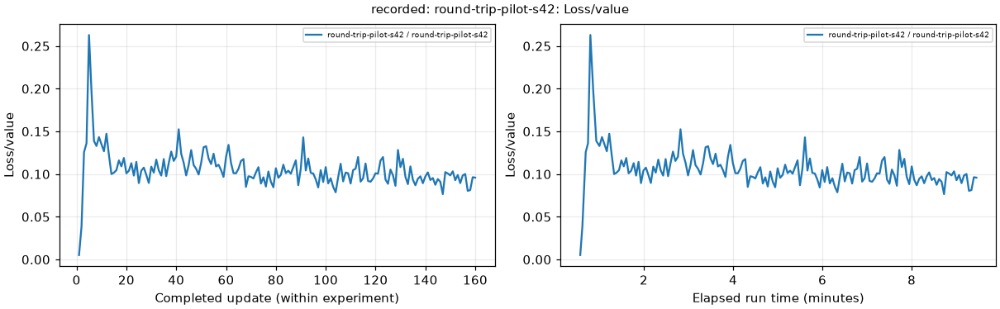

# Fresh-server recovery and direct delivery — 12 November 2026

The new VM started without the previous checkout or results. The repository and pinned dependencies were rebuilt, published results restored, and headless plotting/GitHub delivery verified. **No training was started; all checks performed zero optimizer updates.**

| Check | Observed result |
| --- | --- |
| Initial recovery | 19 previous published run archives restored; zero failures |
| Recovery entry point repeated | 22 existing directories retained, including the new comparison/verification reports; zero failures |
| Videos | Five restored copies matched their source hashes and were 1280 × 720 |
| Headless plotting | Matplotlib `Agg`; PNG rendering passed |
| Direct server upload | Completed using the server's own GitHub access |
| Developer download on Windows | SHA-256 verified; offline gallery and all 89 PNGs verified |
| Uploader independence | Detached process/session; no open Windows watcher required |
| Automatic backlog | 15 published jobs and zero pending uploads at the final status check |
| Full-profile capacity | 1,080 worlds on each T4, checked concurrently |
| GPU communication | NCCL all-reduce and barrier passed |
| Task and phase smoke checks | All 13 task entries passed; existing levels/stages retained |
| Student validation | Separate 972-world validation, reproducibility and state isolation passed |
| Training | Not started; zero optimizer updates; both GPUs idle at completion |

The GPU readiness flag establishes startup/inference readiness. Full held-out policy evaluation was not repeated in this verification (`full_evaluation: false`), and the report makes no claim of newly learned stair performance.

## Downloadable results

- [Restored round-trip pilot plots and data](https://github.com/ahmedelbamby-aast/g1-edu-stairs/releases/tag/run-round-trip-pilot-s42)
- [Fresh GPU readiness archive](https://github.com/ahmedelbamby-aast/g1-edu-stairs/releases/tag/run-reset-recovery-check-20261112)
- [Live server-delivery verification](https://github.com/ahmedelbamby-aast/g1-edu-stairs/releases/tag/run-server-delivery-verified-20261112)
- [Across-run and experiment comparison](https://github.com/ahmedelbamby-aast/g1-edu-stairs/releases/tag/run-experiment-comparisons)

Each new server publication has versioned assets, SHA-256 checksums and `downloads.json`. For the smaller verified plot package:

```bash
python -m scripts.download_github_run --run-id round-trip-pilot-s42 --output ./downloads
```

## Evidence and startup

[Initial restoration receipt](initial-restoration-verified.json), [GPU readiness](readiness.json), [live delivery check](delivery-check.json), [local failure-path tests](delivery-unit-local.json), [Windows developer download](windows-developer-download.json), [service status](final-service-status.json), and [recovery entry-point log](recovery-entrypoint.log).

The older `github_upload` text inside the raw GPU readiness report predates the transport-name change. Actual direct server delivery is established by `delivery-check.json`, the GPU-server publication receipts, and the linked releases. Historical models and curve measurements were preserved; regenerating their plots did not train them again.

Use the [server results guide](../../../doc/server-results.md) for one-command recovery after another reset, service status, retries and developer downloads. The recovery path never starts training. Credentials remain private and outside the checkout and all result archives.



This curve comes from the earlier round-trip pilot. It verifies restoration and plotting of recorded measurements, with update and elapsed-time axes.
